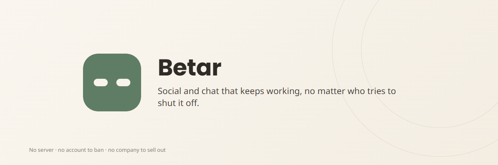

<div align="center">


# Betar

**Social and chat that keeps working, no matter who tries to shut it off.**

[](https://github.com/konkomaji/project-mesh/blob/main/docs/IMPLEMENTATION-STATUS.md)
[](LICENSE)

**[Get it on F-Droid](https://f-droid.org/)** &middot; **[Download the APK](https://github.com/konkomaji/betar/releases)** &middot; **[betar's website](https://konkomaji.github.io/betar/)**

**Developed by [Konko Maji](https://konkomaji.com/)**

</div>

---

I named this app Betar for a reason, and I want that reason on the first page, not buried
in a design document. **Betar** (বেতার) is Bengali for wireless, literally *be-* (without)
*tar* (wire). The mark above is the same idea drawn as a logo: a solid field with a wire
cut out of it, present only as its own absence. The name and the mark both say the same
thing the whole app is built around: nothing routes through a wire anyone else controls.

I built Betar because real governments ban real apps and shut down real networks, not as
a hypothetical. In 2026 alone: Iran had an 88-day nationwide internet shutdown, the longest
on record. France's prime minister asked the country's four mobile carriers to be ready to
block four social platforms for several hours. India ordered GitHub to restrict access to
three Bitchat repositories, citing its anonymous, decentralized design as a problem rather
than a feature. A platform that depends on a server can be subpoenaed, throttled, or shut
off. Betar has none, so there is nothing to subpoena, throttle, or shut off.

## What it does

- **Feed.** Posts live in location-scoped rooms (geohash-based, block to country precision),
  not one global timeline. Reverse-chronological only, nothing ranked by an algorithm.
- **Chat.** Direct messages, groups, and passphrase-protected channels, all end-to-end
  encrypted (Noise, X3DH, post-quantum PQXDH for first contact, MLS for groups).
- **Fact-check, without a moderator.** Anyone can attach a Community Note to a post. A
  public, shared scoring method decides which notes surface, not a person or a company.
- **Works over Bluetooth and Wi-Fi Direct first.** No internet needed for anyone nearby.
  The moment any one device nearby reaches the internet, even briefly, it bridges local
  content to the open Nostr relay network and back, so reach isn't capped by radio range.
- **No phone number, no email, no account to ban.** Your identity is a keypair generated
  on your own device. A short ID (for example `A3F9K2`) is a fingerprint of that key, not
  a separately issued number. Panic wipe and reinstalling both retire it completely and
  start over with a new one.

Full feature list and the reasoning behind each decision: [Project Mesh's
`FEATURES.md`](https://github.com/konkomaji/project-mesh/blob/main/docs/FEATURES.md).

## Built on Project Mesh

Betar is the reference application. The protocol, the cryptography, and the Rust core
(`core/` here, a git submodule) live in
**[Project Mesh](https://github.com/konkomaji/project-mesh)**, one canonical protocol
implementation, so any other app that wants to build on this can depend on the same
core instead of a fork of this one. Read the
[whitepaper](https://github.com/konkomaji/project-mesh/blob/main/WHITEPAPER.md) or the
[threat model](https://github.com/konkomaji/project-mesh/blob/main/docs/THREAT-MODEL.md)
for what this does and does not claim.

## Status

**Pre-alpha.** Debug-signed and release-signed builds both exist (see
[Releases](https://github.com/konkomaji/betar/releases)), but there has been no
independent security audit yet and no two-device hardware verification. Don't rely on
this for anything real yet.

## Why F-Droid first

App stores are themselves a chokepoint. Bitchat, the app that inspired Betar, was pulled
from Google Play and the App Store in India on 2026-10-03, and from Apple's China App
Store in April 2026. Betar ships on F-Droid and as a direct APK download first. A store
listing may exist later as a convenience, never as the only way to get the app.

## Getting the code

`core/` is a git submodule pointing at Project Mesh:

```sh
git clone --recurse-submodules https://github.com/konkomaji/betar.git
```

or, if already cloned:

```sh
git submodule update --init
```

## Building

Requires the Rust core cross-compiled first, see
[`app/src/main/jniLibs/README.md`](app/src/main/jniLibs/README.md). Then:

```sh
./gradlew assembleDebug
```

## License

AGPL-3.0-or-later, see [`LICENSE`](LICENSE).
